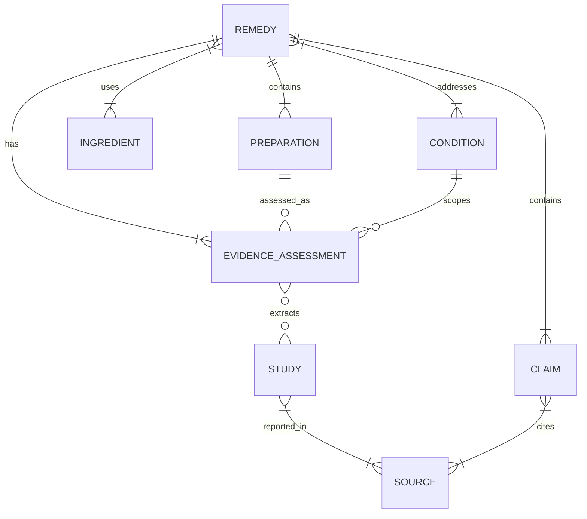

# Data dictionary — schema 1.0.0

The machine-readable contract is `schemas/dataset.schema.json`. Unknown numeric facts are `null`; empty lists mean “none extracted,” not “none exist.” IDs are stable kebab-case strings. Array positions are never identifiers. ISO date strings remain portable and do not automatically become Firestore Timestamp values.

## Canonical model

| Group | Record grain | Principal relationships |
| --- | --- | --- |
| `metadata` | One dataset release | Schema/version/date/audience/source policy and limitations |
| `remedies` | One named preparation or scoped product class | Ingredient IDs, condition IDs, preparation IDs, evidence assessment IDs, embedded claims |
| `ingredients` | One ingredient identity/form | Botanical name where applicable, part/form, identity sources |
| `conditions` | One browse or comparison goal | Symptom, diagnosed condition, or prevention goal |
| `evidenceAssessments` | One remedy/preparation/condition assessment | Population, outcome, direction, certainty, trials, review totals |
| `studies` | One extracted primary study/report group | Cohort, source publications, intervention arms, comparator, counts |
| `sources` | One cited publication/page/version | URL, DOI/PMID where available, publication/access metadata |
| `screeningLog` | One considered candidate decision | Inclusion/exclusion/replacement reason and supporting sources |

Relationships are strings in JSON, not Firestore DocumentReference objects. The validator checks resolution and ownership; Firestore does not supply relational foreign-key enforcement.

## Remedy and embedded records

| Field | Meaning and use |
| --- | --- |
| `id`, `slug`, `name`, `aliases` | Stable identity and display/search names |
| `remedyType` | `food`, `fiber`, `botanical_product`, `topical`, `saline`, or `mineral_product` |
| `summaryClaimIds` | Ordered claim references used for the card and introductory summary |
| `ingredientIds`, `conditionIds` | Reusable identities and browse goals |
| `preparations` | Named formulation and route; each has its own stable ID |
| `culturalContexts` | Multiple separately typed, cited cultural/geographic associations |
| `safety` | Null score plus scoped warnings and knowledge gaps |
| `claims` | Atomic factual prose and citations, shared by detail views |
| `display` | Search terms, tags, and currently null image; not clinical evidence |
| `review` | Editorial status, medical-review status, review date and limits |
| `schemaVersion`, `contentRevision` | Contract version and record revision |

Each claim has `id`, `category`, `text`, `citations`, `verificationStatus`, and `verifiedAt`. Citation objects contain `sourceId`, a human-readable `locator`, and `support` (`supports`, `qualifies`, or `contradicts`). All substantive health, preparation, and cultural statements must resolve to supporting claims. Editorial decisions such as an unknown origin, omitted recipe, or comparison eligibility are explicitly marked as such rather than invented source facts.

A preparation contains `kind`, `route`, `ingredientIds`, `formulationDescription`, `formulationClaimIds`, `guidedUse`, and `studyDoseIsNotInstruction: true`. `guidedUse` is either available with ordered, cited steps or omitted with a reason. Unsupported cooking times, doses, or recipes are not filled in. Trial doses remain text in `studies.interventions[].doseDescription`; numerical dose normalization is intentionally deferred until each product’s active ingredient, elemental amount, unit, frequency, and duration can be checked consistently.

A cultural context contains `associationType`, `regions`, `countryCodes`, `communities`, `narrativeClaimIds`, `originStatus`, `mapAnchor`, and `uncertainty`. `countryCodes` are supported ISO-style alpha-2 associations, not a universal country-of-origin field. Coordinates require a verified source, regional precision, and an explicit representative flag; all are currently null.

A safety item contains `type`, `severity`, `population`, `claimIds`, and `evidenceBasis`. The score fields must remain null/undefined in this version. There is no derived score hidden in the cards or reports. `knowledgeGaps` is a list of cited limitations; an unlisted interaction has not thereby been ruled out.

## Evidence assessment

| Field | Interpretation |
| --- | --- |
| `remedyId`, `preparationId`, `conditionId` | Exact context being assessed |
| `population` | Description, age range when known, source claims, older-adult applicability |
| `outcome` | Specific endpoint; avoid comparing unrelated scales as if equivalent |
| `formulationMatch` | `exact`, `partial`, `indirect`, or `unknown`; `partial` often means review contains several preparations |
| `findingDirection` | `benefit`, `possible_benefit`, `mixed`, `no_clear_benefit`, or `insufficient` |
| `certainty` | Level, attributed method/source, and explanation claims; not an independent AI medical grade |
| `summaryClaimIds`, `limitationClaimIds` | Source-linked interpretation and cautions |
| `studyIds` | Individually extracted primary studies only |
| `reviewSourceIds` | Syntheses/guidance consulted; never added to trial counts |
| `reportedResearch` | Source-reported study/participant counts with their exact scope and claim references |
| `comparison` | Eligibility for same-goal descriptive comparison and curated counts |

`reportedResearch` can contain overlapping subsets of the same review. For example, the cold-duration analysis is a subset of the full zinc prevention/treatment review. Do not sum these rows. `comparison.verifiedStudyCount` equals distinct study IDs; `coverage` explicitly states `curated_not_exhaustive`. A zero here means no primary trial individually extracted, not no research exists. Participant aggregation is null in this release.

## Studies, ingredients, and sources

Study fields preserve design, trial registration when checked, `cohortId`, linked primary sources, population, intervention arms, comparator, enrolled/randomized/analyzed counts, duration, results with claim references, limitations, funding when extracted, and access level. The shared kiwifruit/prune/psyllium trial has multiple arms in one record. A total mixed-diagnosis sample is not relabeled as an osteoarthritis-only sample. Null funding means not extracted, not independently funded.

Ingredients preserve `scientificName` only when meaningful and verified. Honey, saline, and zinc are not assigned fictitious botanical names. `partOrForm` distinguishes leaf oil, root extract, resin, seed, husk, food, and formulated topical material. Ingredient lists describe the food or active medicinal ingredients, not every excipient in every commercial brand. Product labels must be checked for inactive ingredients and allergens. Allergen statements belong in source-linked safety claims; null `allergenNotes` does not assert absence of allergens.

Sources preserve authors, title, publisher, source type, URL, DOI/PMID, date and precision, access date/level, retraction-check status, and notes. A regulatory label supports product warnings and directions; it is not independent trial evidence. Botanical sources support identities/ranges; they are not substituted for clinical efficacy evidence.

## Firestore projection

The six canonical entity arrays become six collections using record IDs as document IDs. `remedyCards` is a generated, compact read model, and `datasetReleases` stores release metadata. Claims, safety, preparations, and culture stay embedded inside remedy documents for this 20-record dataset. They can be split in a versioned migration if growth warrants it. This matches Firestore’s [document and collection model](https://firebase.google.com/docs/firestore/data-model).

Every generated document adds `_datasetId`, `_releaseId`, `_publicationStatus`, and `_contentHash`. The import manifest ties the generated file to the canonical input. Editing generated JSON directly invalidates this check; edit canonical data or fragments and rebuild.
